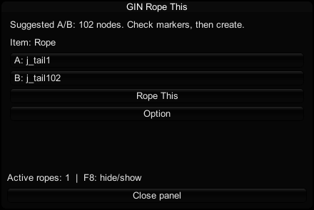

# GIN Rope This

Turn Studio items into movable ropes in **Koikatsu (KK)** and **Koikatsu Sunshine (KKS) CharaStudio**.

**Version 1.1.2** adds automatic length-direction detection and fixes bending for sparse meshes, including cylinders stretched along different axes before conversion.

## Download

| Your game | Installation ZIP |
| --- | --- |
| **Koikatsu / Koikatsu Party (KK)** | **[Download KK version](https://github.com/GoriGinsan/GIN_Rope_This/releases/latest/download/GIN_Rope_This.zip)** |
| **Koikatsu Sunshine (KKS)** | **[Download KKS version](https://github.com/GoriGinsan/GIN_Rope_This/releases/latest/download/GIN_Rope_This_KKS.zip)** |

**Choose the ZIP for your game. You do not need Git, the source code, or a GitHub account.** Both packages install `GIN Rope This.dll`, but the DLLs are different. Install only the matching version in each game.

[All releases](https://github.com/GoriGinsan/GIN_Rope_This/releases) · [Build from source](docs/development.md) · [Tested features](docs/testing.md)

## Requirements

- Your game's **CharaStudio** with [BepInEx 5](https://github.com/BepInEx/BepInEx/releases).
- **KKAPI** for KK, or **KKSAPI** for KKS, from [Illusion Modding API releases](https://github.com/IllusionMods/IllusionModdingAPI/releases).
- Your game's **ExtensibleSaveFormat**, from [BepisPlugins releases](https://github.com/IllusionMods/BepisPlugins/releases), for scene data.
- Optional: your game's **NodesConstraints**, from [HSPlugins releases](https://github.com/IllusionMods/HSPlugins/releases), to attach rope ends to other Studio objects or bones.

Choose **KK** dependency downloads for Koikatsu, or **KKS** downloads for Koikatsu Sunshine. See the [KKS notes](docs/kks.md) for the tested setup.

These dependencies are separate downloads. They are not included in this package.

## Install

1. Close Studio and download the **KK** or **KKS** installation ZIP from the table above.
2. Extract it and copy the **BepInEx** folder into the game folder containing **CharaStudio.exe**. Allow the folders to merge.
3. Start Studio. Open **Option** at the top right, then click **Rope This** in the left-side button group.

The panel starts closed. Click the same button again, use **Close panel**, or press **F8** to hide it.

The ZIP installs just one file:

```text
BepInEx/
  plugins/
    GIN Rope This.dll
```

This is a **BepInEx plugin ZIP**, not a Sideloader `.zipmod`. Install it into the game folder as shown above, not into `mods`.

### Updating an existing installation

Keep only one copy of **GIN Rope This.dll** under `BepInEx/plugins`, including its subfolders. If your older copy is in a subfolder, replace it there or move it outside the plugin folder before installing this package. Keep your existing configuration and scenes.

## Use an item that already has bones

1. Select the item in Studio and open **Rope This**.
2. Check the suggested **A** and **B** endpoints, then click **Rope This** in the panel.
3. Move **GIN Rope A** and **GIN Rope B**, or connect them yourself using **NodesConstraints**.

The plugin suggests endpoints only when it finds an unambiguous supported chain. To choose a smaller section of the chain, open the panel's **Option**, choose **A** or **B**, and click a bone name. The detailed list stays hidden during normal use.



## Add bones to an item

For an item without an FK chain, or with only one bone, click **Rope This**. The plugin automatically finds the principal length direction of the displayed mesh and places a straight chain along it. Item rotation, including depth and diagonal directions, and the current scale are included. You do not need to select Vertical or Horizontal.

Use **Intermediate bones** to choose **3–30** middle points. The default is **10**, plus the two endpoints: **12 bones in total**.

The plugin creates a private mesh copy and weights it to the generated chain. Long triangles are split along the chain so sparse meshes, including cylinders stretched along X, Y, or Z before conversion, can follow bends. Materials, UVs, colors, and the original surface are retained; new vertex attributes are interpolated. Removing the rope restores the original item.

The direction is fitted when the rope is created. Saved ropes retain their existing local endpoints, including ropes made with the older Vertical/Horizontal buttons.

## Adjust, save, or remove

After creation, the panel shows length, gravity, damping, bend stiffness, quality, and pause controls. Connections are handled in NodesConstraints; there are no connection or animation tabs to configure.

Rope settings and generated-rig information are saved with the Studio scene. Scene duplication and restoration are supported. Use **Remove rope (restore item; keep handles)** to restore the item while keeping its two Studio handles.

Authored chains need 3–128 usable nodes. Ambiguous, branched, unreadable, or otherwise unsupported geometry can be refused with a message. Collision handling is not supported. KKS automatic conversion safely refuses meshes with more than four skin influences per vertex. See the [tested scope and limitations](docs/testing.md).

## For developers

- [`src/`](src): complete shared KK/KKS plugin source for **1.1.2**.
- [`assets/`](assets): button images and the original image generator.
- [`tests/`](tests): standalone solver, scene-codec, and mesh-subdivision tests.
- [`build.py`](build.py): local build and installation-ZIP creation.
- [Development guide](docs/development.md): dependencies, build commands, and code map.

Use the **Download** table for installation. GitHub's **Code → Download ZIP** downloads the development files instead.
